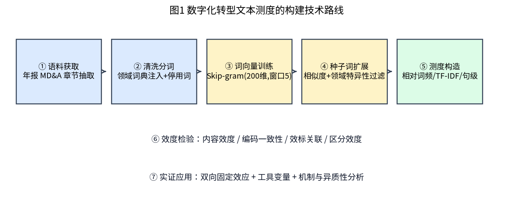
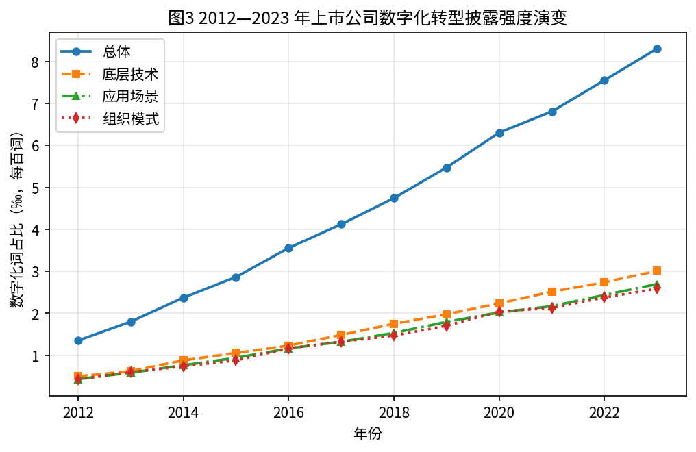
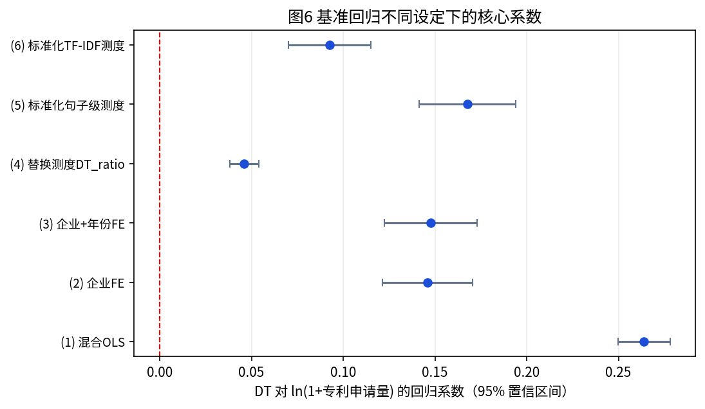
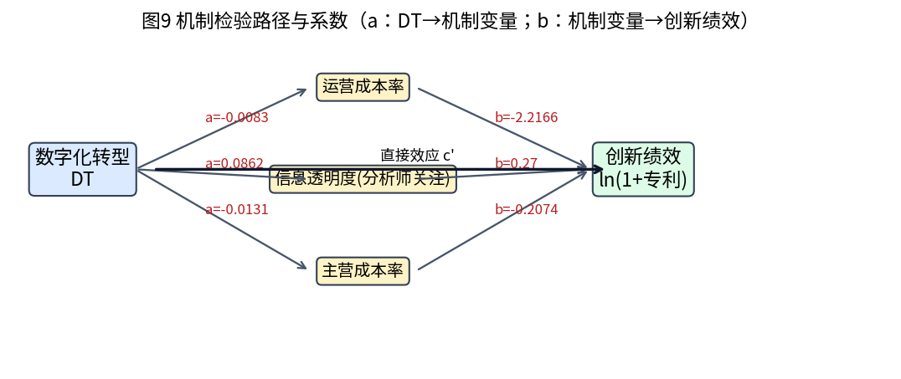

# 企业数字化转型的文本测度构建及其对创新绩效的影响研究

> 大数据管理与应用 · 毕业论文模拟稿 + 全部可复现代码
> **核心方法**：年报 MD&A 语料 → 分层种子词 → Word2Vec 语义扩展 → 领域特异性过滤（keyness）→ 六类测度指标 → 四维效度检验 → 双向固定效应 / 工具变量实证
>
> 📄 **论文正文**：[paper/毕业论文_企业数字化转型文本测度研究.md](paper/毕业论文_企业数字化转型文本测度研究.md)（约 1.46 万字）
> 📘 **Word 稿**：[paper/毕业论文_企业数字化转型文本测度研究.docx](paper/毕业论文_企业数字化转型文本测度研究.docx)

---

## 一句话概括

把"企业数字化转型怎么度量"这件事，从**研究者手工罗列关键词**，变成一条**可复现、可审计、可迁移**的流水线：28 个种子词自动扩展出 74 个专业术语，对预留术语召回率 100%，测度在 6 组词向量参数下的秩相关 ≥ 0.995（Jaccard ≥ 0.97）。

---

## 研究结论速览

| 环节 | 关键结果 |
|---|---|
| 语料 | 300 家企业 × 2012—2023 年，3 600 篇 MD&A，约 502 万字，151.1 万 token |
| 词典 | 最终 102 词（底层技术 37 / 应用场景 42 / 组织模式 23），其中 74 词由词向量自动扩展 |
| 扩展质量 | 预留专业术语召回率 **100%**（46/46） |
| 语义内聚 | LDA 主题空间内聚比 **2.81**（词典词 0.975 vs 随机词 0.347） |
| 人工校验 | 机器测度 vs 人工编码一致率 **87.85%**（Kappa 0.757，AUC 0.941） |
| 效标关联 | 与软件著作权 r = 0.740，与数字化投入 r = 0.612 |
| 参数稳健 | 6 组参数下 Spearman ≥ 0.995，词典 Jaccard ≥ 0.97 |
| 基准回归 | 数字化转型每提高 1 个标准差，专利申请量提高约 **14.8%**（t = 11.41，双向固定效应） |
| 内生性 | IV-2SLS 系数 **0.282**（t = 4.43，一阶段 F ≈ 45.5）＞ FE 的 0.148，符合测量误差衰减理论 |
| 机制 | 运营成本率 ↓、信息透明度 ↑ 两条路径均显著成立 |
| 异质性 | 非国企 0.174 ＞ 国企 0.107；制造业 0.158 ＞ 非制造业 0.137 |

---

## 目录结构

```
.
├── README.md
├── requirements.txt
├── paper/
│   └── 毕业论文_企业数字化转型文本测度研究.md   # 论文正文（约 1.46 万字，含 9 张插图）
├── code/
│   ├── config.py                    # 全局参数：路径、参数设定、种子词、停用词
│   ├── 01_simulate_corpus.py        # ① 语料与面板构造（可替换为真实年报读取）
│   ├── 02_preprocess.py             # ② 清洗、领域词典注入、分词
│   ├── 03_train_word2vec.py         # ③ 词向量训练 + 参数网格
│   ├── 04_expand_lexicon.py         # ④ 语义扩展 + 领域特异性过滤 + 词典定稿
│   ├── 05_construct_measure.py      # ⑤ 六类测度指标构造
│   ├── 06_validity.py               # ⑥ 内容/编码/效标/区分/收敛效度检验
│   ├── 07_regression.py             # ⑦ 基准回归、IV、机制、异质性、稳健性
│   ├── 08_figures.py                # ⑧ 9 张插图
│   ├── 09_robustness_measure.py     # ⑨ 测度参数敏感性 + 敏感性下的回归
│   └── run_all.py                   # 一键复现
├── data/
│   ├── raw/                         # 面板与原始语料（由脚本生成，未纳入版本控制）
│   ├── processed/                   # 分词结果、词频、带测度的面板
│   └── lexicon/                     # 词典、扩充明细、召回检验、词向量模型
└── output/
    ├── tables/                      # table2—table17 全部结果表
    └── figures/                     # fig1—fig9 全部插图
```

---

## 快速开始

```bash
pip install -r requirements.txt

# 一键复现全部流程（约 10 分钟，主要耗时在词向量训练与参数网格）
python3 code/run_all.py

# 只想快速跑通主流程（跳过参数网格），可分别执行：
python3 code/01_simulate_corpus.py
python3 code/02_preprocess.py
python3 code/03_train_word2vec.py --skip-grid
python3 code/04_expand_lexicon.py
python3 code/05_construct_measure.py
python3 code/06_validity.py
python3 code/07_regression.py
python3 code/08_figures.py
```

### 换成真实数据

只需替换第 01 步，产出两个文件即可，**下游代码零改动**：

| 文件 | 必需字段 |
|---|---|
| `data/raw/panel_raw.csv` | firm_id, year, industry, province, soe, size, lev, roa, cash, tangibility, top1, rd_ratio, age, patents, digital_invest, software_copyright, analyst, cost_ratio, opcost |
| `data/raw/mda_corpus.jsonl` | `{"firm_id": "...", "year": 2023, "industry": "C1", "text": "MD&A 正文"}` |

然后执行 `python3 code/run_all.py --from 02`。

真实数据获取建议：年报 PDF 来自巨潮资讯网（cninfo.com.cn），用 `pdfplumber` 或 `PyMuPDF` 做版面分析定位 MD&A 章节；财务数据来自 CSMAR / Wind / 国泰安。

---

## 方法链条（论文第 4 章）

```
年报 MD&A 文本
   │  ① 清洗：全半角统一、剔除数字与图表噪声
   │  ② 领域词典注入 + jieba 分词 + 停用词过滤
   ▼
分词语料（153.5 万 token）
   │  ③ Word2Vec 训练（Skip-gram, 200 维, 窗口 5, 负采样 10）
   │  ④ 28 个种子词 → 每个取相似度 Top-25 近邻（阈值 0.55）
   │  ⑤ 领域特异性过滤 Keyness ≥ 1.5
   │        （高转型组 = 种子词密度前 30%，低转型组 = 后 30%）
   ▼
数字化转型词典（102 词）
   │  ⑥ 计算 6 类指标：相对词频 / TF-IDF / 句子级渗透度 / 三分维度 ...
   ▼
DT_z（标准化测度）→ 效度检验 → 实证回归
```

### 为什么这套流程值得信任

1. **种子词只是锚点，不是答案**——词典的 72% 由数据自动扩展得来，降低了对研究者先验知识的依赖；
2. **领域特异性过滤解决"相似词≠构念词"**——"信息化""自动化""互联网"与数字化语义相近，但它们在高低转型组中分布无差异，Keyness ≈ 1，被自动挡在词典外；
3. **效度是检验出来的，不是声称出来的**——内容效度、人工编码一致性、效标关联、区分效度、收敛效度五类证据全部可复算；
4. **参数不是调出来的**——6 组词向量设定下测度秩相关 ≥ 0.995，直接回应"研究者自由度"质疑。

---

## 输出示例

### 图 1 技术路线


### 图 3 披露强度演变（技术层增速快于组织层）


### 图 6 不同设定下的核心系数（全部显著为正）


### 图 9 机制路径


全部 9 张图见 `output/figures/`；结果表见 `output/tables/`：
table2（描述性统计）、table5（人工编码效度）、table6（效标效度）、table10（基准回归）、
table12（内生性）、table13（机制）、table14（异质性）、table15（稳健性）、table16/17（参数敏感性）。

---

## 重要说明（学术诚信）

本仓库的**面板数据与年报语料由参数化模拟器生成，并非真实上市公司数据**。

这样做有两个目的：一是规避免版权与数据库许可问题；二是保留了**已知的真实转型强度 `dt_latent`**，从而可以量化文本测度的还原能力（r = 0.909），并验证"测量误差导致 OLS 向下衰减、IV 修正衰减"这一经典理论预期——这是真实数据中无法完成的检验。

论文中对这一点有明确陈述（第 4.1.2 节）。**方法与代码完全适用于真实数据**，替换方式见上文"换成真实数据"。

---

## 环境

Python 3.11 · jieba · gensim（Word2Vec）· scikit-learn（LDA/TF-IDF）· linearmodels（面板 IV）· statsmodels · pandas · matplotlib · wordcloud
