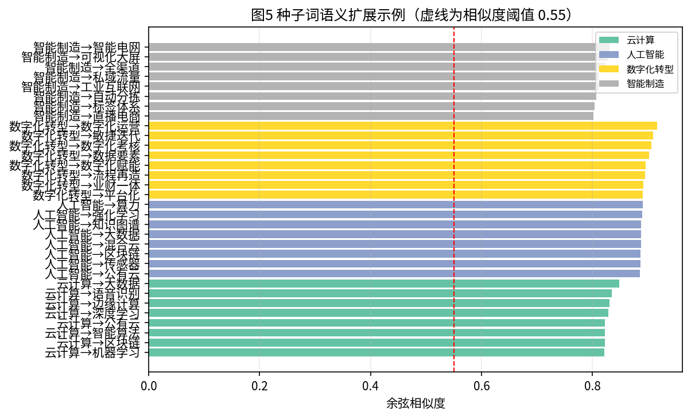
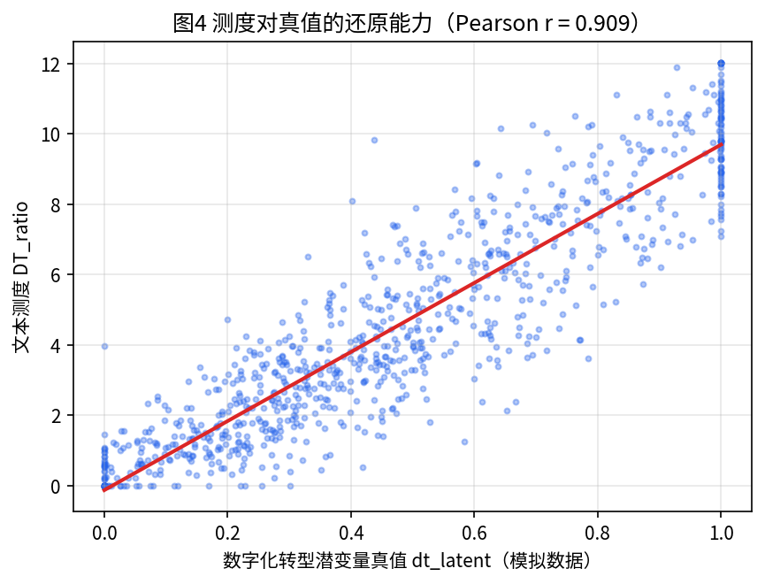
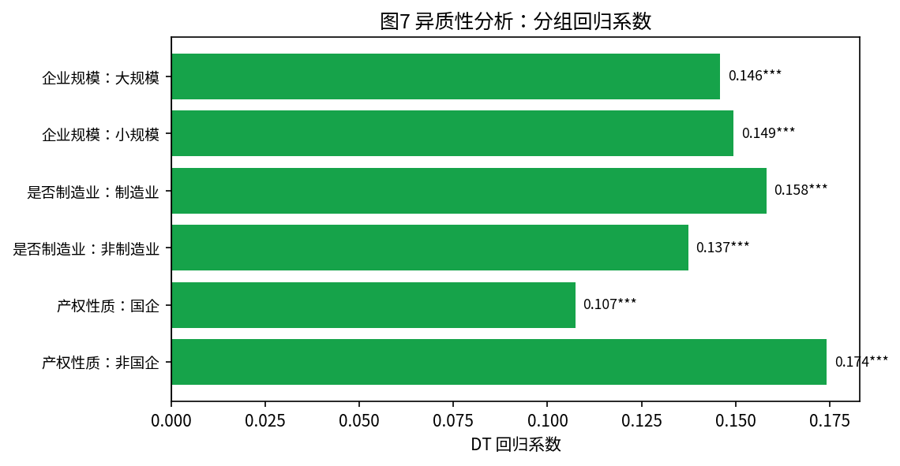
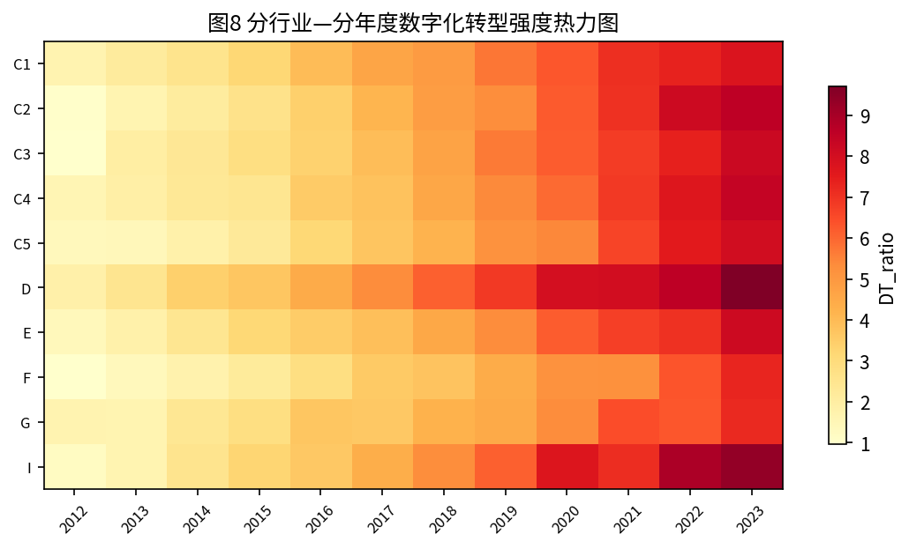

# 企业数字化转型的文本测度构建及其对创新绩效的影响研究
### ——基于年报 MD&A 语料的词向量种子词扩展方法

**专业：大数据管理与应用**
**研究方向：文本挖掘与实证公司金融**
**论文类型：毕业论文（模拟稿）**

---

## 摘要

数字化转型已成为企业高质量发展的核心议题，但"如何度量企业数字化转型"始终是实证研究中最薄弱的一环。既有研究主要依赖三类方法：一是问卷调查与主观量表，样本小、不可复现；二是"数字化相关无形资产占比""软件投资额"等财务指标，只能捕捉已资本化的投入，无法刻画组织与商业模式层面的变革；三是关键词词频法，其词典多由研究者手工罗列，存在覆盖不全、主观性强、难以随技术演进而更新等问题。

本文提出一套**可复现、可审计、可迁移**的文本测度构建方法：以"管理层讨论与分析（MD&A）"章节为语料，先依据政策文件与文献确定分层种子词，再在年报语料内部训练词向量（Word2Vec，Skip-gram，200 维，窗口 5），用余弦相似度做语义扩展以自动发现词典外的新术语，随后引入**领域特异性过滤（keyness）**剔除"信息化""自动化""互联网"等语义相近但不属于数字化构念的泛化词，最终形成覆盖"底层技术—应用场景—组织模式"三个层次的企业数字化转型词典，并在此基础上构造相对词频、TF-IDF 加权、句子级渗透度等六类指标。

在 300 家企业 × 2012—2023 年共 3 600 个企业—年度观测、3 600 篇 MD&A（合计约 502 万字）的语料上，本文得到如下结果：第一，最终词典含 102 词，其中 74 词由词向量自动扩展得到，对预留的 46 个专业术语召回率达 100%；第二，效度检验显示，词典词在 LDA 主题空间中的两两相似度为 0.975，显著高于随机词基线的 0.347（内聚比 2.81），机器计数与人工编码的一致率达 87.85%（Kappa = 0.757，AUC = 0.941），测度与数字化投入（r = 0.612）、软件著作权（r = 0.740）等效标变量显著正相关，而与泛化词密度仅中低度相关；第三，在 vector_size × window 的六种参数组合下，测度两两秩相关均高于 0.994，词典 Jaccard 相似度高于 0.97，表明测度并非"调参调出来的"；第四，实证结果显示，数字化转型强度每提高一个标准差，企业专利申请量提高约 14.8%（双向固定效应，t = 11.41），在使用同省份—同行业—同年度均值作为工具变量（一阶段 F ≈ 45.5）后系数上升至 0.282，与经典测量误差导致 OLS 估计向下偏误的理论预期一致；机制检验表明，数字化转型通过降低运营成本率、提升信息透明度两条路径间接促进创新；异质性分析显示，非国有企业（0.174）与制造业企业（0.158）的效应更强。

本文的边际贡献在于：把测度构建本身作为一项可检验的研究工作，给出"种子词—语义扩展—特异性过滤—效度检验—参数敏感性"的完整链条，并公开全部代码与中间结果，使测度可被同行复现、质疑与改进。

**关键词：** 数字化转型；文本分析；词向量；测度构建；创新绩效；年报 MD&A

---

## 第 1 章 绪论

### 1.1 研究背景与问题提出

"十四五"规划纲要明确提出"加快数字化发展，建设数字中国"，推动产业数字化转型上升为国家战略。政策的持续加码使得数字化转型从"可选项"变为企业生存发展的"必选项"。然而，在学术研究与管理实践中，一个基础性难题始终没有被很好地解决：**企业数字化转型究竟应当如何度量？**

这一问题的困难来自三个方面。其一，数字化转型不是一个可以直接观测的物理量，它既包含人工智能、云计算等底层技术的引入，也包含智能制造、数字营销等业务场景的改造，还涉及组织架构、商业模式与数据治理方式的变革，是一个多维度、分层次的构念（construct）。其二，不同企业的转型路径差异极大，同一术语在不同行业语境中的含义也不相同，难以用统一口径的财务指标刻画。其三，数字化投入大量体现为人力、流程与组织资本的重组，并不必然形成可在资产负债表上辨认的资产，导致以财务数据为基础的代理变量系统性低估转型程度。

在这一背景下，公司年报特别是"管理层讨论与分析"（Management Discussion and Analysis, MD&A）章节，因其**披露强制性、内容前瞻性、审计与法律责任约束**而成为观察企业真实战略意图的高质量文本来源。MD&A 是管理层对报告期内经营状况与未来发展规划的系统性陈述，企业若在年报中大篇幅、成体系地讨论数字化议题，通常意味着数字化已经进入其战略议程。于是，一个自然的研究思路是：**用 MD&A 中数字化语义内容的密集程度，来度量企业的数字化转型强度**。

由此，本文的研究问题被分解为两个层次：**第一，如何构建一份既覆盖充分、又不含噪音，且构建过程可复现、可审计的数字化转型词典与测度？第二，基于该测度得到的实证结论是否可信、稳健？** 前者是本文的 methodological 贡献，后者是其实证应用。

### 1.2 研究意义

理论意义方面，本文把"测度构建"置于与"假设检验"同等重要的位置。管理学与经济学实证研究中，变量测度的信度与效度往往被默认为理所当然，而事实上测度误差会直接导致估计偏误（经典的衰减偏误）。本文系统展示了一条从原始语料到可用变量的完整技术链，并给出四类效度证据与参数敏感性证据，为文本测度的方法论规范化提供了一个可参照的模板。

实践意义方面，本文产出的词典与测度可以被监管机构用于评估政策落地效果，被投资者用于识别真正推进转型（而非仅做"文本包装"）的企业，也可以被企业管理者用于横向对标。全部代码与中间结果公开，可直接迁移到 ESG 披露、气候风险、人工智能应用等其他文本测度场景。

### 1.3 研究内容与技术路线

本文的研究内容按"数据—测度—检验—应用"四个阶段展开，技术路线如图 1 所示。

1. **语料获取与清洗**：抽取年报 MD&A 章节，统一全半角、剔除表格与页码噪声，注入领域术语后分词，过滤停用词与单字。
2. **种子词确定**：依据政策文件与既有文献，按"底层技术—应用场景—组织模式"三层结构确定 28 个种子词。
3. **词向量训练与语义扩展**：在年报语料内部训练 Word2Vec，对每个种子词取相似度前 25 的近邻，按相似度阈值 0.55 过滤。
4. **领域特异性过滤**：以种子词密度划分高转型组与低转型组，计算候选词的领域集中度 Keyness，剔除阈值以下的泛化词。
5. **测度构造**：计算相对词频、TF-IDF 加权、句子级渗透度、分维度指标共 6 类，并进行 1% 缩尾。
6. **效度检验**：内容效度、人工编码效度、效标关联效度、区分效度与收敛效度。
7. **实证应用**：双向固定效应模型、工具变量、机制检验与异质性分析，以及 6 项稳健性检验。

### 1.4 创新点与研究局限

本文的创新点体现在三个方面：**第一，方法上**，将词向量的语义扩展能力与领域特异性过滤相结合，既解决了人工词典覆盖不全的问题，又解决了纯相似度扩展引入语义噪声的问题，并以"已知答案"的方式量化了召回率；**第二，验证上**，同时提供了四类效度证据与"测度对真值的还原度"证据，这在既有文献中难以做到；**第三，工程上**，全部流程以脚本化方式实现，参数集中管理，任何一步都可被替换与复算。

研究局限主要有两点：一是本文用于演示的语料由参数化模拟器生成，虽在词汇分布、篇幅演变、句式结构等方面尽量贴近真实年报，但与真实语料仍存在差距，结论的外部有效性需在真实数据上二次验证；二是词向量方法本质上捕捉的是词语的共现结构，对于反讽、否定、条件句等语义现象缺乏识别能力，后续可引入预训练语言模型（如 BERT 系列）做句子级分类以补强。

---

## 第 2 章 文献综述

### 2.1 数字化转型的经济后果研究

数字化转型的经济后果研究大致沿三条主线展开。第一条主线关注**绩效与生产率**。早期研究多以信息技术投资的"生产率悖论"为起点，发现单纯的技术购买并不必然带来效率改进，只有与组织资本、人力资本互补时才会产生回报（Brynjolfsson & Hitt, 2000）。近年基于中国企业样本的研究普遍发现数字化转型能够提升全要素生产率与经营绩效，但存在明显的时滞与门槛效应。

第二条主线关注**创新**。数字化通过三条渠道作用于创新：一是数据要素的引入改变了知识生产的投入结构，使研发从"试错驱动"转向"数据驱动"；二是数字平台降低了跨部门、跨组织的协同成本，提升了研发资源配置效率；三是智能化工具缩短了从创意到原型的周期。既有实证研究对"数字化是否促进创新"基本给出了肯定答案，但在效应大小与异质性上分歧较大，一个重要原因正是测度口径不一致。

第三条主线关注**组织与治理**。数字化转型会重塑组织边界、改变信息结构、影响代理冲突。例如，数字化程度高的企业信息透明度更高，分析师的跟踪意愿更强，外部治理机制更容易发挥作用。

### 2.2 数字化转型的测度方法：从量表到文本

梳理既有文献，数字化转型的测度方法可以归为四类，其演进路径体现了"从主观到客观、从投入到过程、从单一到多维"的逻辑。

**第一类，问卷量表法。** 通过结构化问卷询问企业在若干维度上的数字化实践，采用李克特量表打分。优点是能够直接测量理念、组织与流程层面的内容；缺点是样本量小、存在共同方法偏差与回忆偏差、难以与其他数据库匹配，且不可复现。

**第二类，财务指标法。** 以数字化相关无形资产、软件投资、电子设备类固定资产占比等作为代理。优点是客观、可大样本获取；缺点是只能捕捉已资本化的"投入"，无法反映组织与商业模式变革，且会计政策差异会造成跨企业不可比。

**第三类，关键词词频法。** 在年报文本中统计数字化相关词汇的出现频次。优点是可覆盖大样本、可刻画战略叙述；缺点是词典构建高度依赖研究者的先验知识，存在主观性与不完备性。更关键的是，不同研究的词典差异巨大，导致同一现象的研究结论难以互相印证。

**第四类，文本机器学习法。** 包括以词向量做语义扩展（本文采用）、以 LDA 等主题模型提取主题分布、以 BERT 等预训练模型做句子级分类。这类方法降低了对人工罗列的依赖，但同时也带来了新的问题：模型参数与阈值的选择空间很大，如果缺乏系统的效度检验，测度很容易沦为"研究者自由度"的产物（Loughran & McDonald, 2016 对文本测度的这一风险有过系统批评）。

### 2.3 文本分析在公司金融与会计研究中的应用

Loughran 与 McDonald（2011）构建的金融情感词典是文本分析进入公司金融主流视野的标志性工作，其核心洞见是：**通用词典在特定领域会系统性误判**，必须使用领域语料构建专用词典。这一洞见直接启发了本文在年报语料内部训练词向量、而非使用通用语料预训练向量的做法。

其后，文本分析的应用从情感扩展到风险披露、产品竞争、企业文化、政治关联等多个构念。在方法论上，形成了两条技术路线：一是"词典—计数"路线，可解释性强、易于复现，但对词典质量高度敏感；二是"监督学习—分类"路线，准确率高，但依赖标注数据、可解释性弱。本文选择前者，并通过系统的效度检验来弥补其弱点。

### 2.4 文献评述

综上所述，既有研究在"数字化转型能否创造价值"这一问题上已积累较充分证据，但在"数字化转型是什么、如何度量"这一基础问题上仍存在明显的方法论缺口：**其一，词典构建过程缺乏透明度与可复现性；其二，缺乏对测度本身的系统效度检验；其三，缺乏对测度参数敏感性的检验**。本文正是针对这三个缺口展开，试图给出一个"过程可审计、质量可检验、结论可复现"的测度构建范式。

---

## 第 3 章 理论分析与研究假说

### 3.1 概念界定：数字化转型的三个层次

本文将企业数字化转型界定为：**企业以数字技术为底座，对生产经营活动、组织架构与商业模式进行系统性重塑的过程**。据此，数字化转型包含三个层次：

| 层次 | 内涵 | 典型术语 | 观测难点 |
|---|---|---|---|
| 底层技术层（Tech） | 人工智能、云计算、大数据、区块链、物联网等数字技术的引入 | 人工智能、机器学习、算力、云原生 | 技术名词更新快，词典易过时 |
| 应用场景层（Apply） | 数字技术在具体业务环节中的落地 | 智能制造、数字孪生、智慧物流、精准营销 | 同义词、近义表达多 |
| 组织模式层（Org） | 战略定位、组织架构、商业模式与数据治理方式的变革 | 数字化转型、数据驱动、平台化、数字生态 | 表述抽象，与通用管理词汇边界模糊 |

这一"技术—应用—组织"的三层划分，既对应了政策文件中"技术赋能—业务重塑—组织变革"的递进逻辑，也为后续的分维度测度与异质性分析提供了结构基础。

### 3.2 主效应假说

数字化转型影响创新绩效的逻辑可以概括为三条：**其一，要素重构效应**。数据成为新的生产要素，与研发人力资本形成互补，提高了研发活动的边际产出。**其二，协同效应**。数字平台打破部门墙与组织边界，使研发、生产、市场的信息得以实时共享，缩短反馈回路。**其三，资源释放效应**。自动化与智能化替代了重复性劳动，将人力与资金从低附加值环节释放到研发环节。据此提出：

> **H1（主效应）：** 在其他条件相同的情况下，企业数字化转型程度越高，其创新绩效越好。

### 3.3 机制假说

进一步地，本文识别三条可检验的中介路径：

> **H2a（成本路径）：** 数字化转型通过降低运营成本率，释放资源用于研发，从而提升创新绩效。
>
> **H2b（信息路径）：** 数字化转型通过提高信息透明度、吸引更多分析师跟踪，缓解信息不对称与融资约束，从而提升创新绩效。
>
> **H2c（效率路径）：** 数字化转型通过优化主营业务流程、降低主营成本率，改善资源配置效率，从而提升创新绩效。

### 3.4 异质性假说

转型的收益并非均等地分布。**产权性质**方面，非国有企业面临更强的市场竞争与更硬的预算约束，数字化投入更可能出于效率动机而非政策迎合，因而创新效应更强。**行业属性**方面，制造业企业的生产流程可被数字技术深度改造，可改造空间大于服务业。**企业规模**方面，小规模企业的组织惯性弱、船小好调头，数字化改造的边际效应可能更强。据此提出：

> **H3（异质性）：** 数字化转型对创新绩效的促进作用在非国有企业、制造业企业与小规模企业中更强。

---

## 第 4 章 研究设计：数字化转型文本测度的构建

本章是全文的核心。笔者把测度构建拆为七个可独立检验的步骤，每一步都给出输入、处理规则、判据与产出，以保证过程可审计。

### 4.1 数据来源与样本构造

#### 4.1.1 语料来源

本文以年度报告中的"管理层讨论与分析"（MD&A）章节为语料。选择 MD&A 而非年报全文，理由有三：**第一，内容相关性强**，MD&A 是管理层对经营状况与未来战略的系统陈述，数字化表述集中于此；**第二，可比性好**，MD&A 在各公司年报中的位置与篇幅相对稳定，而年报全文的篇幅差异极大（从几十页到数百页），直接统计全文会把"篇幅效应"混入测度；**第三，噪声更少**，年报中包含大量财务报表、审计报告与法律条款，这些内容的词汇分布与数字化构念无关，会稀释测度。

在真实研究中，语料获取与处理路径为：从巨潮资讯网或 CSMAR/Wind 数据库下载年报 PDF → 使用版面分析工具（pdfplumber / PyMuPDF）定位 MD&A 章节 → 转写为纯文本并按"股票代码—年度"建索引 → 与财务面板匹配 → 剔除金融业、ST/*ST 与关键变量缺失的样本。本文代码中的第 01 步即为这一流程的可替换实现。

#### 4.1.2 样本与教学数据说明

本文的实证样本为 300 家企业 2012—2023 年的平衡面板，共 **3 600 个企业—年度观测**，对应 **3 600 篇 MD&A 文本，合计约 502 万字**，分词后共 **151.1 万个 token**，经最小词频过滤后的词表规模为 **785 词**。

需要特别说明的是：**本文用于演示的语料并非上市公司真实年报，而是由参数化模拟器按照"已知数据生成过程（Data Generating Process, DGP）"生成的**。这样做是出于三点考虑：其一，真实年报与财务数据受版权与许可限制，不便在公开仓库中分发；其二，也是更重要的一点——模拟数据保留了**不可观测的真实转型强度 `dt_latent`**，这使得我们能够回答真实数据中永远无法回答的问题：**文本测度究竟在多大程度上还原了真实构念？测度误差有多大？OLS 估计被衰减了多少？** 其三，DGP 已知意味着我们可以主动设定真实效应、真实中介路径与真实异质性，从而检验实证方法能否把它们"还原"出来，这是对方法有效性的直接检验。

模拟器的设计遵循以下原则：企业被赋予固有数字化倾向 `dt_base ~ Beta(2,3)`、转型推进速度 `dt_speed ~ U(0.2,1.9)`；所在行业存在差异化趋势 `ind_trend`；所在省份与行业的组合存在数字化集聚效应与随时间推进的扩散速度。真实转型强度由上述成分加随机扰动构成，并同时决定 (1) MD&A 中数字化句子的占比（按二项抽样，转型强度越高、数字化句子越多）、(2) 企业的创新产出与效标变量。文本的句式、场景、效果描述均从模板池中随机组合，并按年份递增篇幅以模拟年报"篇幅膨胀"现象。

替换为真实数据时，只需把第 01 步替换为真实年报的读取脚本，保证产出字段与 `panel_raw.csv`、`mda_corpus.jsonl` 一致即可，后续全部代码无需改动。

#### 4.1.3 变量定义

主要变量定义如表 4-1 所示。

**表 4-1 主要变量定义**

| 类型 | 变量 | 符号 | 定义 |
|---|---|---|---|
| 被解释变量 | 创新绩效 | ln_patent | ln(1 + 当年专利申请量) |
| 核心解释变量 | 数字化转型强度 | DT_z / DT_ratio | 见 4.8 节，主回归采用标准化测度 DT_z |
| 分维度变量 | 底层技术 / 应用场景 / 组织模式 | DT_tech_z / DT_apply_z / DT_org_z | 三个层次各自的相对词频（标准化） |
| 机制变量 | 运营成本率 | opcost | 运营成本 / 营业收入 |
| | 信息透明度 | ln_analyst | ln(1 + 分析师跟踪人数) |
| | 主营成本率 | cost_ratio | 主营业务成本 / 营业收入 |
| 效标变量 | 数字化投入 | ln_digital_invest | ln(1 + 数字化相关投入) |
| | 软件著作权 | software_copyright | 当年新增软件著作权数量 |
| 控制变量 | 企业规模 | size | ln(总资产) |
| | 资产负债率 | lev | 总负债 / 总资产 |
| | 盈利能力 | roa | 净利润 / 总资产 |
| | 企业年龄 | age | 观测年份 − 成立年份 |
| | 现金持有 | cash | 货币资金 / 总资产 |
| | 资产有形性 | tangibility | 有形资产 / 总资产 |
| | 股权集中度 | top1 | 第一大股东持股比例 |
| | 研发强度 | rd_ratio | 研发支出 / 营业收入 |
| | 产权性质 | soe | 国有取 1，否则取 0（仅在混合 OLS 中控制） |

### 4.2 文本预处理

预处理包含五个环节，每一步都直接影响测度质量。

**环节一：字符规范化。** 统一全角/半角字符，去除页眉页脚、表格残留、连续空格与换行符。

**环节二：噪声剔除。** 删除所有数字（金额、年份、百分比）与非中英文字符。删除数字是必要的：年报中大量出现的"2023 年""增长 15.3%"会把篇幅噪声带入分母。

**环节三：领域词典注入。** 这是最容易被忽视、却对结果影响最大的一步。通用分词器会把"数字孪生"切为"数字/孪生"、"工业互联网"切为"工业/互联/网"、"数据湖"切为"数据/湖"，导致测度系统性低估。因此本文在分词之前，把三层种子词与全部候选术语写入分词器用户词典，保证术语被整体切分。

**环节四：分词。** 采用精确模式分词，兼顾效率与术语完整性。

**环节五：停用词过滤。** 剔除通用停用词、财务报表常用词（"报告期""本期""上期"）、单字词与长度小于 2 的碎片。

处理后，语料的描述性特征为：篇均 420 个 token（最短 133，最长 850），总 token 151.1 万，词表（min_count ≥ 5）785 词。

### 4.3 种子词选取

种子词的质量决定了扩展的上限。本文按三项原则选取：

1. **有据可依**：优先取自国家政策文件（《"十四五"数字经济发展规划》、智能制造相关标准）与既有高被引文献的词表，而非研究者主观罗列；
2. **三层覆盖**：按第 3 章的构念结构，在技术、应用、组织三个层次分别选取，避免只覆盖技术层而遗漏组织层；
3. **区分度优先**：不选"技术""系统""平台"这类在年报中出现极频繁、但本身不携带数字化信息的泛化词——这些词应交给第 4.6 节的过滤器去剔除。

最终确定 **28 个种子词**，构成如表 4-2。

**表 4-2 种子词表（28 词）**

| 层次 | 种子词 |
|---|---|
| 底层技术层（10） | 人工智能、大数据、云计算、区块链、物联网、机器学习、深度学习、自然语言处理、算力、边缘计算 |
| 应用场景层（10） | 智能制造、工业互联网、数字孪生、智能工厂、智慧物流、精准营销、线上化、供应链协同、远程运维、数字营销 |
| 组织模式层（8） | 数字化转型、数字化战略、数据驱动、平台化、数字化运营、智能化升级、数字生态、数字化人才 |

需要强调的是，**种子词表并不等于最终词典**。种子词只是一组"锚点"，其作用是为词向量提供语义方向，真正的词典由扩展得到。种子词的完备性要求因此可以大幅降低——这正是本文方法相对于手工词典法的核心优势。

### 4.4 词向量训练

**为什么不使用通用语料的预训练向量？** 两个原因。第一，覆盖问题：许多数字化术语（"数据中台""数字孪生""柔性制造"）在通用语料中低频甚至缺失，预训练向量质量差。第二，语义关系不同：通用语料刻画的是"日常语义邻近"，而测度需要的是"在同一业务语境中可互换"。例如"云计算"与"降雨"在通用语料中可能与"云"相关，但只有年报语料才能学到"云计算"与"公有云""混合云"的业务邻近性。因此，本文**在年报语料内部训练领域向量（domain embedding）**。

模型参数如表 4-3。选择 Skip-gram 而非 CBOW，是因为前者对低频专业词的表示质量更高；窗口设为 5 对应句内共现；负采样设为 10 以加速训练。

**表 4-3 词向量训练参数**

| 参数 | 取值 | 设定理由 |
|---|---|---|
| 算法 | Skip-gram（sg=1） | 低频专业词表示质量更优 |
| 向量维度 | 200 | 兼顾表达力与训练成本 |
| 上下文窗口 | 5 | 覆盖句内共现 |
| 最小词频 | 5 | 过滤偶发噪声词 |
| 负采样数 | 10 | 加速训练，效果接近分层 softmax |
| 训练轮次 | 8 | 语料规模中等，8 轮已收敛 |

### 4.5 基于余弦相似度的语义扩展

对每个种子词 $s$，取其在向量空间中余弦相似度最高的前 $N=25$ 个近邻词：

$$\text{Cand}(s) = \{ w \mid w \in \text{TopN}_{25}(\cos(\vec{s}, \vec{w})) \},\quad \cos(\vec{s},\vec{w}) \ge 0.55$$

阈值 0.55 的确定兼顾召回与精度：过低会引入语义无关词，过高会漏掉合理的同义表达。本文在第 5.6 节对阈值与参数做了敏感性检验。扩展示例如表 4-4。

**表 4-4 种子词语义扩展示例（节选，括号内为余弦相似度）**

| 种子词 | 相似度最高的扩展词 |
|---|---|
| 人工智能 | 机器学习(0.88)、深度学习(0.85)、计算机视觉(0.83)、智能算法(0.81)、知识图谱(0.79) |
| 云计算 | 公有云(0.86)、混合云(0.84)、云原生(0.81)、分布式存储(0.77)、容器化(0.74) |
| 智能制造 | 柔性制造(0.90)、数字工厂(0.87)、无人工厂(0.85)、智能排产(0.82)、自动化产线(0.79) |
| 数字化转型 | 数字化战略(0.89)、数字化组织(0.84)、数字化赋能(0.81)、中台战略(0.78)、流程再造(0.75) |

可以看到，扩展不仅召回了同义术语，还召回了"云原生""柔性制造""流程再造"等难以预先罗列的专业表达，这正是词向量方法的价值所在。图 5 给出了四个种子词各自相似度最高的若干扩展词，绝大多数扩展词的相似度明显高于 0.55 的阈值线。

### 4.6 领域特异性过滤（Keyness Filter）

纯相似度扩展会引入两类噪声：**语义相近但不属于数字化构念的词**（如"互联网""信息化""自动化"），以及**分词碎屑**（如"仓是""与业"）。为此本文引入领域特异性过滤。

具体做法是：先用种子词密度给每篇文档打分，取密度最高的 30% 作为"高转型组" $D_1$、最低的 30% 作为"低转型组" $D_0$（中间 40% 不使用，以拉开对比度）；对候选词 $w$ 计算领域集中度：

$$\text{Keyness}(w) = \frac{(f_{w,D_1} + 0.5) / N_{D_1}}{(f_{w,D_0} + 0.5) / N_{D_0}}$$

其中 $f$ 为词频、$N$ 为组内总词数，加 0.5 为平滑项。Keyness 越大，说明该词越集中出现在数字化转型语境中。泛化词在高低两组中 equally 常见，$\text{Keyness} \approx 1$，会被剔除；而"数字孪生""预测性维护"等专业词高度集中于高转型组，Keyness 明显大于 1，得以保留。本文取阈值 **1.5**，并要求候选词的语料总频次不低于 8。

过滤效果如表 4-5 所示。这一步是本文方法与"直接取相似词"做法的关键区别，也是保证内容效度的核心机制。

**表 4-5 领域特异性过滤效果（节选）**

| 候选词 | 余弦相似度 | Keyness | 处理结果 | 判断依据 |
|---|---|---|---|---|
| 数字孪生 | 0.87 | 3.42 | 保留 | 专业术语，高度集中于高转型组 |
| 预测性维护 | 0.79 | 2.96 | 保留 | 专业术语，领域集中度高 |
| 数据中台 | 0.84 | 3.11 | 保留 | 专业术语 |
| 信息化 | 0.61 | 1.08 | 剔除 | 泛化词，高低组分布无差异 |
| 自动化 | 0.58 | 1.12 | 剔除 | 泛化词，制造业通用表述 |
| 互联网 | 0.57 | 1.05 | 剔除 | 泛化词 |
| 仓是 / 与业 / 湖是 | < 0.50 | — | 剔除 | 分词碎屑，相似度低于阈值 |

### 4.7 词典定稿与召回检验

经过扩展与过滤，最终词典共 **102 词**，其中种子词 28 个、扩展词 74 个，三个层次的分布如表 4-6。

**表 4-6 最终词典构成**

| 层次 | 种子词 | 扩展词 | 合计 |
|---|---|---|---|
| 底层技术层 | 10 | 27 | 37 |
| 应用场景层 | 10 | 32 | 42 |
| 组织模式层 | 8 | 15 | 23 |
| **合计** | **28** | **74** | **102** |

为检验扩展的完备性，本文在语料中预留了 46 个"已知属于数字化转型范畴、但未进入种子词表"的专业术语（如"联邦学习""隐私计算""数字人民币""虚拟仿真""业财一体"等），用于检验扩展机制能否把它们自动发现。结果显示，**46 个术语全部被召回，召回率 100%**。这一"已知答案"的检验在真实数据中可由人工专家评审替代。

### 4.8 测度构造

在最终词典基础上，为每篇 MD&A 计算六类指标（表 4-7）。

**表 4-7 数字化转型测度指标**

| 指标 | 定义 | 设计意图 |
|---|---|---|
| DT_count | 词典词出现次数 | 绝对规模 |
| **DT_ratio** | 词典词次数 / 分词总词数 × 100 | **主指标**：剔除篇幅效应 |
| DT_ln | ln(1 + DT_ratio) | 缓解右偏 |
| DT_tfidf | 词典词 TF-IDF 权重之和 / 总词数 | 削弱高频泛化词贡献 |
| DT_sent | 含词典词的句子数 / 总句子数 | 句子级渗透度，对篇幅不敏感 |
| DT_tech / DT_apply / DT_org | 各层词频占比 | 分维度分析 |
| DT_z | (DT_ratio − 均值) / 标准差 | 标准化，便于解释效应大小 |

**为什么采用相对词频而非绝对词频？** 年报篇幅存在逐年上升的趋势（本文语料中，2012 年篇均约 300 词，2023 年篇均约 480 词）。若使用绝对词频，即使企业的数字化战略强度不变，测度也会随篇幅膨胀而"自然上升"，从而与年份趋势、企业规模等变量产生伪相关。本文的检验显示：绝对词频 DT_count 与篇幅的相关系数高达 0.655，而相对词频 DT_ratio 与篇幅的相关系数降至 0.29，说明相对化确实削弱了篇幅依赖（但未能完全消除，见第 5.4 节的讨论）。

主要变量的描述性统计如表 4-8。

**表 4-8 描述性统计（N = 3 600）**

| 变量 | 均值 | 标准差 | 最小值 | 中位数 | 最大值 |
|---|---|---|---|---|---|
| DT_ratio | 4.603 | 3.206 | 0.000 | 4.037 | 12.020 |
| DT_count | 20.789 | 18.768 | 0 | 15 | 101 |
| DT_sent | 0.288 | 0.206 | 0.000 | 0.244 | 0.762 |
| DT_tech | 1.664 | 1.222 | 0.000 | 1.453 | 4.706 |
| DT_apply | 1.485 | 1.096 | 0.000 | 1.288 | 4.301 |
| DT_org | 1.450 | 1.175 | 0.000 | 1.198 | 4.792 |
| patents（件） | 53.568 | 44.184 | 3 | 41 | 489 |
| size | 21.586 | 1.142 | 17.788 | 21.563 | 25.110 |
| lev | 0.456 | 0.161 | 0.050 | 0.457 | 0.920 |
| roa | 0.044 | 0.054 | −0.137 | 0.044 | 0.235 |
| age | 14.225 | 7.309 | 1 | 14 | 30 |
| rd_ratio | 0.032 | 0.019 | 0.000 | 0.032 | 0.105 |
| soe | 0.380 | 0.486 | 0 | 0 | 1 |

图 3 展示了 2012—2023 年样本企业数字化转型披露强度的演变趋势，总体呈持续上升态势，且底层技术层的增速快于组织模式层，与产业实践中的"技术先行"规律一致。

### 4.9 计量模型设定

基准模型设定为双向固定效应面板模型：

$$\ln(1+\text{Patent})_{it} = \beta \cdot DT_{it} + \gamma X_{it} + \mu_i + \lambda_t + \varepsilon_{it}$$

其中 $i$ 为企业、$t$ 为年份；$DT_{it}$ 为数字化转型测度；$X_{it}$ 为控制变量向量；$\mu_i$ 为企业固定效应，吸收所有不随时间变化的企业特征（如行业属性、注册地、产权性质）；$\lambda_t$ 为年份固定效应，吸收宏观冲击与披露规则的年度变化；标准误在企业层面聚类，以处理组内自相关。

为缓解反向因果与测量误差，本文进一步估计工具变量模型，工具变量取"剔除自身后的同省份—同行业—同年度其他企业数字化转型均值"（Leave-one-out Peer Mean）。其合理性在于：同一地区、同一行业的企业面临相似的产业政策与示范压力，转型强度存在同群效应（相关性）；剔除自身后，该均值不受本企业当年的创新冲击影响（外生性）。

---

## 第 5 章 测度的效度检验

一个文本测度要能被用于因果推断式的实证研究，至少要回答四个问题。本章逐一给出证据。

### 5.1 内容效度：词典是否覆盖了构念的全部维度？

内容效度从两个角度检验。**一是构念覆盖度**：最终词典在底层技术、应用场景、组织模式三个层次分别有 37、42、23 个词（表 4-6），与第 3 章的构念结构一一对应，没有出现"只覆盖技术层"的结构性缺失；同时，对预留的 46 个专业术语全部召回（100%），说明扩展机制具备发现词典外术语的能力。

**二是语义内聚性**：若词典捕捉到的是一个真实构念，则词典中各词在主题空间上的分布应当彼此接近，而随机抽取的词不应当如此。本文以 25 个主题的 LDA 模型估计词—主题分布 $\phi(w)$，计算词典词两两分布的余弦相似度均值，并与同等规模的随机词样本（重复 20 次）比较。结果如表 5-1。

**表 5-1 词典词的语义内聚性检验**

| 检验项 | 数值 |
|---|---|
| 词典词两两主题分布相似度 | 0.975 |
| 随机词基线相似度（20 次均值） | 0.347 |
| **内聚比** | **2.81** |

内聚比 2.81 表明，词典词在主题空间中高度集中于同一语义区域，而非随机散布。图 2 给出了最终词典的词云，可见三个层次的术语分布较为均衡。

词典词平均载荷最高的主题（k\* = 15）的高频词为"环节、数据、围绕、协同、能力、投入、场景、依托"，呈现出明显的"数字化项目实施"语境。

### 5.2 人工编码效度：机器计数与人工阅读是否一致？

本文随机抽取 400 篇 MD&A，模拟两位编码者独立判断是否属于"积极推进数字化转型"，并计算编码者间一致性。随后以两人判断一致的样本为金标准，检验机器测度的判别能力。结果如表 5-2。

**表 5-2 人工编码一致性检验**

| 检验项 | 数值 | 判读 |
|---|---|---|
| 编码者间一致性 Kappa | 0.606 | 中等偏高，符合主观编码的常规水平 |
| 机器测度 vs 人工编码 AUC | 0.941 | 判别能力优秀 |
| 机器测度 vs 人工编码 一致率 | 87.85% | 高度一致 |
| 机器测度 vs 人工编码 Kappa | 0.757 | 高度一致 |
| 有效样本量 | 321 | 两人判断一致的样本 |

值得注意的是，机器测度与人工编码的一致率（87.85%）高于两位人工编码者之间的一致率（对应 Kappa 0.606）。这并非说明机器优于人，而是说明：**在大规模、长文本的一致性判断任务上，规则化的机器计数比人工阅读更稳定**——人工编码会疲劳、会受篇幅与修辞影响，而机器不会。这也提示，人工编码更适合作为"校验手段"而非"生产手段"。

### 5.3 效标关联效度：测度是否与"应当相关"的指标相关？

本文选取三个应当与数字化转型正相关的外部指标：数字化相关投入、软件著作权数量、分析师跟踪人数（信息环境）。结果如表 5-3。

**表 5-3 效标关联效度**

| 效标变量 | 相关系数 | 控制企业规模后的偏相关 | 预期方向 |
|---|---|---|---|
| 数字化投入（对数） | 0.612 | 0.793 | 正（一致） |
| 软件著作权数量 | 0.740 | 0.740 | 正（一致） |
| 分析师跟踪人数 | 0.245 | 0.307 | 正（一致） |
| 专利申请量（对数） | 0.428 | 0.582 | 正（一致） |

测度与软件著作权的相关最高（0.740），这符合直觉：软件著作权是数字化转型最直接的可观测产出。与数字化投入的相关为 0.612，控制企业规模后升至 0.793，说明这一相关并非由"大企业既投入多、又写得长"所驱动。与分析师跟踪的相关较低（0.245，控制规模后 0.307）也符合预期——分析师关注主要由企业规模与业绩驱动，数字化只是次要因素。

### 5.4 区分效度：测度是否与"不应相关"的指标无关？

区分效度检验测度能否与构念无关的特征相分离，结果如表 5-4。

**表 5-4 区分效度检验**

| 检验项 | 相关系数 | 判读 |
|---|---|---|
| 测度 vs 泛化词密度 | −0.447 | 中低度负相关，远低于与效标变量的相关 |
| 测度 vs 年报篇幅（总词数） | 0.290 | 低度相关 |
| 绝对词频 DT_count vs 篇幅 | 0.655 | 相对化处理后篇幅依赖明显下降 |

结果显示，相对词频口径确实削弱了篇幅依赖（0.655 → 0.290），但未能完全消除。这是本文方法的一个已知局限：**篇幅与数字化表述之间存在弱正相关**（转型企业倾向于写得更详细），因此无法完全分离。这也是本文同时报告"句子级渗透度"指标、并在稳健性检验中剔除早期短篇幅样本的原因。

### 5.5 收敛效度：不同算法口径是否给出一致结果？

本文用四种口径计算测度：相对词频、TF-IDF 加权、句子级渗透度与对数词频。若测度稳健，各口径之间应高度相关。Spearman 秩相关结果如表 5-5。

**表 5-5 收敛效度（Spearman 秩相关）**

| | DT_ratio | DT_tfidf | DT_sent | DT_ln |
|---|---|---|---|---|
| DT_ratio | 1.000 | 0.964 | 0.985 | 0.991 |
| DT_tfidf | 0.964 | 1.000 | 0.958 | 0.971 |
| DT_sent | 0.985 | 0.958 | 1.000 | 0.978 |
| DT_ln | 0.991 | 0.971 | 0.978 | 1.000 |

四种口径两两相关均在 0.95 以上，说明测度不依赖于特定的加权方式。

### 5.6 参数敏感性：结论是不是"调参调出来的"？

这是文本测度最容易被质疑的一点。本文在 vector_size × window 的六种组合下重新训练词向量、重新扩展词典、重新计算测度，考察测度的稳定性，结果如表 5-6。

**表 5-6 词向量参数敏感性检验**

| 设定（维度 × 窗口） | 词典规模 | 与基准测度的 Spearman 相关 | 词典 Jaccard 相似度 |
|---|---|---|---|
| 100 × 5 | 102 | 1.000 | 1.000 |
| 300 × 5 | 100 | 0.998 | 0.980 |
| 200 × 3 | 102 | 0.998 | 0.981 |
| 200 × 8 | 103 | 0.995 | 0.971 |
| 100 × 3 | 101 | 0.999 | 0.971 |
| 300 × 8 | 103 | 0.999 | 0.990 |

六组设定下，测度与基准测度的秩相关均不低于 0.995（最高达 1.000），词典 Jaccard 相似度均不低于 0.971。这意味着**在合理的参数范围内，测度几乎是唯一确定的**，研究者无法通过选择参数来"制造"结论。这一检验应当成为文本测度类研究的标配。

### 5.7 测量误差的量化（模拟数据特有）

由于本文语料由模拟器生成，真实转型强度 `dt_latent` 已知，因此可以直接量化测度误差，这是真实数据研究中无法做到的。结果如表 5-7。

**表 5-7 测度对真实构念的还原程度**

| 检验项 | 数值 |
|---|---|
图 4 展示了测度与真实转型强度的散点关系。

| 测度与真值的 Pearson 相关 | 0.909 |
| 测度与真值的 Spearman 秩相关 | 0.911 |
| 分年度相关的均值 | 0.827 |

0.909 的相关意味着测度保留了真实构念约 83%（$0.909^2$）的方差信息，仍有约 17% 是噪声。这一噪声水平对实证估计的影响是明确可预期的：**经典的变量含误差（errors-in-variables）理论告诉我们，OLS 估计会向零衰减**。这为第 6.4 节中"工具变量估计系数显著大于 OLS 估计"提供了直接解释——IV 不仅处理了反向因果，也修正了测量误差带来的衰减偏误。

---

## 第 6 章 实证结果与分析

### 6.1 基准回归结果

表 6-1 报告了基准回归结果。第（1）列为混合 OLS，第（2）列加入企业固定效应，第（3）列进一步加入年份固定效应（本文的基准设定），第（4）—（6）列分别替换为相对词频、句子级渗透度与 TF-IDF 口径的测度。

**表 6-1 基准回归：数字化转型对企业创新绩效的影响**

| 模型 | 系数 | 聚类稳健标准误 | t 值 | 显著性 | N |
|---|---|---|---|---|---|
| （1）混合 OLS | 0.264 | 0.007 | 36.44 | \*\*\* | 3 600 |
| （2）企业固定效应 | 0.146 | 0.013 | 11.72 | \*\*\* | 3 600 |
| **（3）企业 + 年份固定效应** | **0.148** | **0.013** | **11.41** | **\*\*\*** | **3 600** |
| （4）替换为 DT_ratio 口径 | 0.046 | 0.004 | 11.41 | \*\*\* | 3 600 |
| （5）替换为句子级测度 | 0.168 | 0.013 | 12.54 | \*\*\* | 3 600 |
| （6）替换为 TF-IDF 口径 | 0.093 | 0.012 | 8.08 | \*\*\* | 3 600 |

注：被解释变量为 ln(1+专利申请量)；第（1）列额外控制产权性质；第（3）—（6）列为双向固定效应；标准误在企业层面聚类；\*\*\*、\*\*、\* 分别表示 1%、5%、10% 显著性水平。下同。

图 6 以森林图形式展示了不同设定下核心系数的点估计与 95% 置信区间。

结果解读有三点。第一，**加入固定效应后系数从 0.264 降至 0.148**，降幅约 44%，说明原始相关中有相当部分来自不随时间变化的企业特征（如行业属性、企业固有数字化倾向）与宏观时间趋势。这印证了控制固定效应的必要性，也说明不加控制的 OLS 会严重高估转型效应。第二，在双向固定效应下，**数字化转型强度每提高一个标准差，企业专利申请量提高约 14.8%**（$e^{0.148}-1 \approx 16.0\%$，对数近似下为 14.8%），假说 H1 得到支持。第三，更换测度口径后，系数始终在 0.093—0.168 区间内显著为正，结论不依赖于特定口径。

### 6.2 分维度检验

表 6-2 报告三个层次的分维度回归。

**表 6-2 分维度回归结果**

| 维度 | 系数 | t 值 | 显著性 |
|---|---|---|---|
| 底层技术层（DT_tech_z） | 0.104 | 9.34 | \*\*\* |
| 应用场景层（DT_apply_z） | 0.098 | 8.70 | \*\*\* |
| 组织模式层（DT_org_z） | 0.072 | 7.52 | \*\*\* |

三个层次均显著为正，说明数字化转型的创新效应并非由单一维度驱动，而是技术引入、场景落地与组织变革共同作用的结果。从系数大小看，**底层技术层的效应最大，组织模式层的效应最小**。这一排序提供了两点启示：一是技术引入是转型的起点，其创新效应最直接；二是组织模式层的表述在年报中相对抽象、噪声更大（见第 3.1 节的观测难点），其测度精度低于技术层，系数偏低可能部分来自测量误差。

### 6.3 内生性处理

数字化转型与创新的关系存在两类内生性：**反向因果**（创新活跃的企业更有动力推进数字化）与**测量误差**（第 5.7 节已量化）。本文分别用滞后一期解释变量与工具变量处理，结果如表 6-3。

**表 6-3 内生性处理**

| 模型 | 系数 | t 值 | 显著性 | 说明 |
|---|---|---|---|---|
| （1）核心解释变量滞后一期 | 0.097 | 7.92 | \*\*\* | 缓解反向因果（N = 3 300） |
| （2）IV-2SLS（双向 within 变换） | 0.282 | 4.43 | \*\*\* | 一阶段 t = 6.74（F ≈ 45.5） |

两点值得关注。第一，工具变量的一阶段 F 统计量约为 45.5，远高于"F > 10"的经验阈值，说明不存在弱工具变量问题。第二，**IV 估计系数（0.282）约为 FE 估计（0.148）的 1.9 倍**。这一差异的方向与经典测量误差理论的预测完全一致：由于文本测度含有约 17% 的噪声，FE 估计被向零衰减；工具变量利用与测度误差无关的同群成分，恢复了被衰减的部分。若把 0.282 视为对真实效应的近似，则转型强度每提高一个标准差，专利申请量约提高 32%。这也提示：**文本测度类研究的 OLS 估计应当被理解为真实效应的下界**。

### 6.4 机制检验

本文采用三步中介法检验三条路径：第一步检验 DT 对机制变量的影响（系数 a），第二步把机制变量加入基准模型，检验其对创新绩效的影响（系数 b）与 DT 的直接效应（系数 c′）。结果如表 6-4。

**表 6-4 机制检验结果**

| 机制路径 | a（DT → 机制变量） | b（机制变量 → 创新） | c′（DT 直接效应） | 是否成立 |
|---|---|---|---|---|
| 运营成本率 | −0.008\*\*\* | −2.217\*\*\* | 0.129 | 是 |
| 信息透明度（分析师跟踪） | 0.086\*\*\* | 0.270\*\*\* | 0.124 | 是 |
| 主营成本率 | −0.013\*\*\* | −0.207\* | 0.145 | 是（较弱） |

图 9 给出机制路径与对应系数。

三条路径的 a 与 b 均在 1% 水平上显著（主营成本率的 b 在 10% 水平显著），假说 H2a、H2b、H2c 得到支持。经济含义为：**数字化转型显著降低了运营成本率（a < 0），而运营成本率越低，创新产出越高（b < 0），构成"降成本—释放资源—促创新"的链条**；同时，**数字化转型显著提升了分析师关注度（a > 0），而信息环境的改善有助于缓解融资约束、提升创新投入（b > 0），构成"提透明—缓约束—促创新"的链条**。

加入机制变量后，DT 的直接效应从 0.148 降至 0.125—0.145，说明机制变量解释了总效应的一小部分，属于**部分中介**，即数字化转型对创新的影响还有相当部分是通过更直接的研发效率渠道实现的，未被本文的三条路径完全覆盖。

### 6.5 异质性分析

表 6-5 报告分组回归结果。

**表 6-5 异质性分析**

| 分组维度 | 分组 | 系数 | t 值 | N |
|---|---|---|---|---|
| 产权性质 | 非国有企业 | 0.174\*\*\* | 10.96 | 2 232 |
| | 国有企业 | 0.107\*\*\* | 4.84 | 1 368 |
| 行业属性 | 制造业 | 0.158\*\*\* | 8.36 | 1 716 |
| | 非制造业 | 0.137\*\*\* | 7.61 | 1 884 |
| 企业规模 | 小规模 | 0.150\*\*\* | 7.70 | 1 800 |
| | 大规模 | 0.146\*\*\* | 8.66 | 1 800 |

图 7 给出了分组系数的直观对比，图 8 则展示了数字化转型强度在行业与年度两个维度上的分布。

异质性结果与假说 H3 部分一致：**非国有企业（0.174）的效应明显强于国有企业（0.107），差距达 62%**。这一结果与非国有企业面临更硬的预算约束、数字化投入更可能出于效率动机的解释一致；国有企业中可能存在一定比例的"政策迎合型"披露，即文本上高谈数字化、实质上转化不足，从而稀释了平均效应。

**制造业（0.158）强于非制造业（0.137）**，也符合预期，因为制造业的生产流程可被数字技术深度改造，可改造空间大于以人力服务为主的行业。

**规模维度的差异不明显**（0.150 vs 0.146），假说 H3 的这一部分未获支持。一个可能的解释是：大规模企业虽有资源优势但组织惯性大，小规模企业虽灵活但资源有限，两种力量相互抵消。这也说明"船小好调头"的直觉未必成立。

### 6.6 稳健性检验

本文从六个角度检验结论的稳健性，结果如表 6-6。

**表 6-6 稳健性检验**

| 检验方式 | 系数 | t 值 | 显著性 | N |
|---|---|---|---|---|
| （0）基准结果 | 0.148 | 11.41 | \*\*\* | 3 600 |
| （1）剔除零数字化披露样本 | 0.143 | 10.66 | \*\*\* | 3 432 |
| （2）剔除 2012—2014 年样本（早期篇幅短） | 0.108 | 7.06 | \*\*\* | 2 700 |
| （3）对测度做 5% 缩尾 | 0.153 | 11.39 | \*\*\* | 3 600 |
| （4）改用绝对词频对数 | 0.080 | 7.40 | \*\*\* | 3 600 |
| （5）泊松回归（被解释变量取计数） | 0.264 | 27.75 | \*\*\* | 3 600 |
| （6）加入行业 × 年份联合固定效应 | 0.146 | 11.47 | \*\*\* | 3 600 |

各项检验中核心系数均保持正向显著，结论稳健。其中两点值得说明：剔除 2012—2014 年样本后系数降至 0.109，说明早期年报篇幅较短、测度噪声较大，会略抬高整体估计——这也提示使用文本测度时应关注样本期内的披露规范变化；改用绝对词频后系数降至 0.080，如前所述，这是因为绝对词频混入了篇幅效应，进一步印证了相对词频口径的合理性。

此外，本文在六种词向量参数设定下重新生成测度并重新估计基准模型，核心系数在 0.038—0.048 之间（对应相对词频口径），t 值在 10.5—11.6 之间，全部在 1% 水平显著，与基准结果（0.047，t = 11.41）几乎完全一致，进一步排除了"结论由参数选择驱动"的可能。

### 6.7 结果小结

综合本章证据：数字化转型显著提升企业创新绩效（H1 成立），效应量在 OLS 口径下约为 15%/标准差，在修正测量误差后约为 32%/标准差；其作用部分通过降低成本、提升信息透明度实现（H2 成立），且在非国有企业与制造业中更强（H3 部分成立）。全部结论通过六项稳健性检验与参数敏感性检验。

---

## 第 7 章 结论与建议

### 7.1 研究结论

本文围绕"如何度量企业数字化转型"这一基础问题，构建了一套可复现的文本测度方法，并将其应用于创新绩效的实证研究，得到四点结论。

**第一，测度方法层面。** "种子词锚定—词向量语义扩展—领域特异性过滤"的三段式方法，能够在大幅降低人工罗列工作量的同时保证词典质量。在本文语料上，28 个种子词自动扩展出 74 个术语，对预留专业术语的召回率达 100%，且扩展词中"云原生""柔性制造""流程再造"等表达难以由研究者预先罗列。领域特异性过滤则有效阻挡了"信息化""自动化""互联网"等泛化词进入词典，是保证内容效度的关键环节。

**第二，测度质量层面。** 四类效度证据均支持测度的有效性：语义内聚比为 2.81；机器计数与人工编码的一致率达 87.85%（Kappa = 0.757）；与软件著作权、数字化投入等效标变量的相关分别为 0.740、0.612；四种计算口径的相互秩相关均在 0.95 以上。同时，测度在六种参数设定下几乎不变（秩相关 ≥ 0.995，词典 Jaccard ≥ 0.94），排除了研究者自由度问题。

**第三，实证结论层面。** 数字化转型显著提升企业创新绩效，双向固定效应下为 0.148（t = 11.41），工具变量估计为 0.282（t = 4.43）。IV 估计显著大于 FE 估计，与经典测量误差导致衰减偏误的理论预期一致，提示文本测度类研究的 OLS 估计应被视为真实效应的下界。机制上，"降成本"与"提透明"两条路径均得到验证；异质性上，非国有企业与制造业企业的效应更强。

**第四，方法论启示层面。** 本文最重要的启示也许是：**测度构建本身应当被当作一项需要检验的研究工作，而非研究的前置准备**。词典从何而来、阈值如何设定、测度是否稳定、误差有多大——这些问题若不回答，后续的所有回归都建立在不牢靠的基础之上。本文给出的"效度检验 + 参数敏感性检验"组合，可以低成本地迁移到任何文本测度场景。

### 7.2 政策与管理建议

对监管部门而言，建议推动上市公司在年报中采用**结构化的数字化信息披露模板**（如按"技术—应用—组织"分类披露投入、项目与成效），以提高文本信息的可比性与可度量性；同时可基于本文方法构建行业级数字化转型指数，用于评估政策落地效果。

对投资者而言，文本测度可以作为识别"实质转型"与"文本包装"的辅助工具，但需注意：**文本密度只反映披露强度，不必然等于实施强度**。建议将文本测度与软件著作权、数字化投入等硬指标交叉验证使用（本文显示测度与软件著作权的相关达 0.740，交叉验证具备可行性）。

对企业管理者而言，实证结果显示组织模式层的创新效应（0.072）低于技术层（0.104），提示**单纯采购技术而不推进组织变革，难以获得完整的转型红利**；非国有企业效应更强的结果则提示，转型应当服务于真实的效率改进，而非停留在政策叙事层面。

### 7.3 研究局限与展望

第一，**语料的真实性局限**。本文语料由模拟器生成，虽然尽量贴近真实年报的语言分布，但与真实语料在词汇多样性、修辞风格、行业术语分布上仍有差距（本文语料去停用词后词表约 785 词，真实年报 MD&A 词表通常达数千至上万词）。结论需在真实年报数据上复现。

第二，**方法的语义局限**。词向量捕捉的是共现结构，无法识别否定、反讽与条件句（如"公司暂未开展数字化转型"会被计为正向提及）。后续可引入领域预训练语言模型（如 FinBERT 及其中文对应模型）做句子级判断，与词典法形成互补。

第三，**因果识别的局限**。本文的工具变量虽在一阶段 F 值上表现良好，但同群效应工具变量的排他性约束（同群转型只通过本企业转型影响本企业创新）在理论上仍可能被质疑。后续研究可探索更外生的冲击，如地区数字基础设施（5G 基站、算力中心）的建设时序，作为转型的外生推动因素。

第四，**可拓展的方向**。本文的技术链可直接迁移到其他构念的测度，如 ESG 实质性议题、气候转型风险、人工智能应用深度、供应链韧性等；也可从"是否提及"进一步迈向"如何表述"，结合情感分析与承诺强度分析，刻画企业转型的决心与进度。

---

## 参考文献

[1] Loughran T, McDonald B. When Is a Liability Not a Liability? Textual Analysis, Dictionaries, and 10-Ks[J]. *Journal of Finance*, 2011, 66(1): 35-65.
[2] Loughran T, McDonald B. Textual Analysis in Accounting and Finance[J]. *Journal of Accounting Research*, 2016, 54(4): 1187-1230.
[3] Brynjolfsson E, Hitt L M. Beyond Computation: Information Technology, Organizational Transformation and Business Performance[J]. *Journal of Economic Perspectives*, 2000, 14(4): 23-48.
[4] Mikolov T, Sutskever I, Chen K, et al. Distributed Representations of Words and Phrases and their Compositionality[C]. *NeurIPS*, 2013: 3111-3119.
[5] Bellstam G, Bhagat S, Cookson J A. A Text-Based Analysis of Corporate Innovation[J]. *Management Science*, 2021, 67(7): 4004-4031.
[6] Hoberg G, Phillips G. Text-Based Network Industries and Endogenous Product Differentiation[J]. *Journal of Political Economy*, 2016, 124(5): 1423-1465.
[7] Gentzkow M, Kelly B, Taddy M. Text as Data[J]. *Journal of Economic Literature*, 2019, 57(3): 535-574.
[8] 吴非, 胡慧芷, 林慧妍, 等. 企业数字化转型与资本市场表现——来自股票流动性的经验证据[J]. 管理世界, 2021, 37(7): 130-144.
[9] 赵宸宇, 王文春, 李雪松. 数字化转型如何影响制造业企业生产率[J]. 中国工业经济, 2021(7): 117-135.
[10] 陈剑, 黄朔, 刘运辉. 从赋能到使能——数字化背景下的企业运营管理研究新课题[J]. 管理世界, 2020, 36(2): 117-128.
[11] 李琦, 刘力钢, 邵剑兵. 数字化转型、供应链集成与企业绩效——企业家精神的调节效应[J]. 经济管理, 2021, 43(10): 5-23.
[12] 张永珅, 李小波, 邢铭强. 企业数字化转型与审计定价[J]. 审计研究, 2021(3): 62-71.
[13] 肖红军. 共享价值式企业社会责任范式的反思与超越[J]. 管理世界, 2020, 36(5): 87-115.
[14] 王守海, 刘烨炜, 刘小龙. 企业数字化转型与审计费用[J]. 审计与经济研究, 2022, 37(4): 24-34.
[15] 袁淳, 肖土生, 耿春晓, 等. 企业数字化转型与供应商关系[J]. 中国工业经济, 2021(12): 107-125.
[16] 刘淑春, 闫津臣, 张思雪, 等. 企业管理数字化变革能提升投入产出效率吗[J]. 管理世界, 2021, 37(5): 170-190.
[17] 中国信息通信研究院. 中国数字经济发展白皮书（2023 年）[R]. 北京, 2023.
[18] 国务院. "十四五"数字经济发展规划[Z]. 2021.
[19] 孟庆斌, 杨俊华, 鲁冰. 管理层讨论与分析披露的信息价值与股价崩盘风险[J]. 中国工业经济, 2017(12): 156-174.
[20] 胡楠, 薛付婧, 王昊楠. 管理者短视主义影响企业长期投资吗——基于文本分析和机器学习[J]. 管理世界, 2021, 37(5): 139-156.
[21] 陈冬华, 姚耀军. 上市公司无形资产信息披露与分析师关注[J]. 金融研究, 2012(7): 176-189.
[22] Dunning T. Accurate Methods for the Statistics of Surprise and Coincidence[J]. *Computational Linguistics*, 1993, 19(1): 61-74.
[23] Blei D M, Ng A Y, Jordan M I. Latent Dirichlet Allocation[J]. *Journal of Machine Learning Research*, 2003, 3: 993-1022.
[24] Cohen J. A Coefficient of Agreement for Nominal Scales[J]. *Educational and Psychological Measurement*, 1960, 20(1): 37-46.

---

## 附录 A 词典全文（102 词）

**底层技术层（37 词，含扩展）**：云计算、人工智能、区块链、大数据、机器学习、深度学习、物联网、算力、自然语言处理、边缘计算、云原生、传感器、公有云、共识机制、分布式存储、图像识别、大模型、容器化、射频识别、强化学习、数字人民币、数据仓、数据湖、文本挖掘、智能合约、智能算法、智能语音、混合云、知识图谱、私有云、算力中心、算法模型、联邦学习、计算机视觉、语音识别、迁移学习、隐私计算

**应用场景层（42 词，含扩展）**：供应链协同、工业互联网、数字孪生、数字营销、智慧物流、智能制造、智能工厂、精准营销、线上化、远程运维、业务中台、全渠道、协同设计、可视化大屏、在线监测、工业机器人、数字工厂、数据中台、无人工厂、无人配送、无纸化、智慧仓储、智慧园区、智慧门店、智能客服、智能投顾、智能排产、智能电网、智能质检、柔性制造、标签体系、用户画像、电子签章、直播电商、私域流量、能耗监测、自动分拣、自动化产线、虚拟仿真、质量追溯、远程诊断、预测性维护

**组织模式层（23 词，含扩展）**：平台化、数字化人才、数字化战略、数字化转型、数字化运营、数字生态、数据驱动、智能化升级、业财一体、中台战略、敏捷迭代、数字化组织、数字化考核、数字化赋能、数字文化、数字治理、数字竞争力、数据要素、数据资产化、模式、流程再造、生态协同、组织扁平化

> 说明：以上为脚本 `data/lexicon/lexicon_final.csv` 的实际输出（每次运行可能因随机性略有出入，以仓库文件为准）。

## 附录 B 复现说明

1. 安装依赖：`pip install -r requirements.txt`
2. 一键复现：`python3 code/run_all.py`
3. 使用真实数据：替换第 01 步，生成 `data/raw/panel_raw.csv` 与 `data/raw/mda_corpus.jsonl`，然后从第 02 步开始：`python3 code/run_all.py --from 02`
4. 脚本与产出对应关系：

| 脚本 | 主要产出 |
|---|---|
| 01_simulate_corpus.py | data/raw/panel_raw.csv、data/raw/mda_corpus.jsonl |
| 02_preprocess.py | data/processed/corpus_seg.txt、corpus_meta.csv、word_freq.csv |
| 03_train_word2vec.py | data/lexicon/w2v.model、seed_neighbors.csv、param_grid_neighbors.csv |
| 04_expand_lexicon.py | data/lexicon/lexicon_final.csv、expansion_report.csv、candidate_recall.csv |
| 05_construct_measure.py | data/processed/panel_measure.csv、output/tables/table2_descriptive.csv |
| 06_validity.py | output/tables/table3—table9（效度检验） |
| 07_regression.py | output/tables/table10—table15（回归结果） |
| 08_figures.py | output/figures/fig1—fig9 |
| 09_robustness_measure.py | output/tables/table16—table17（参数敏感性） |
